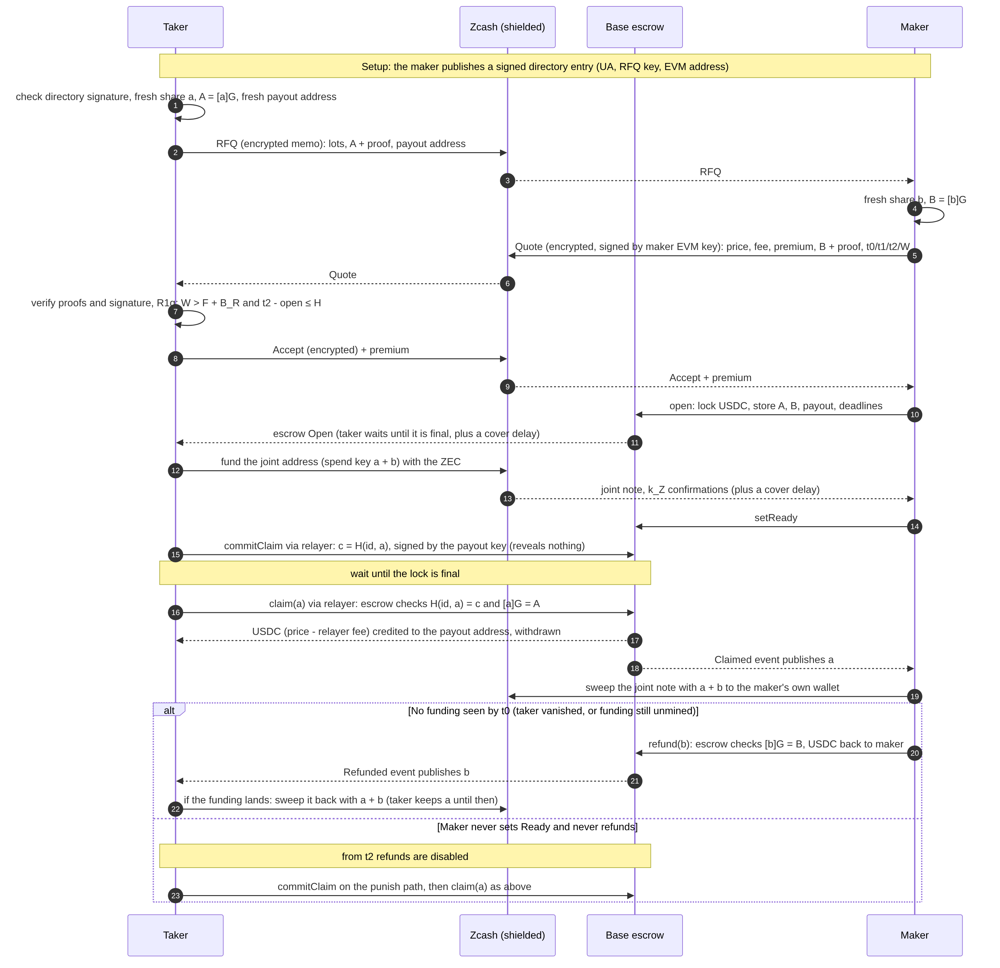
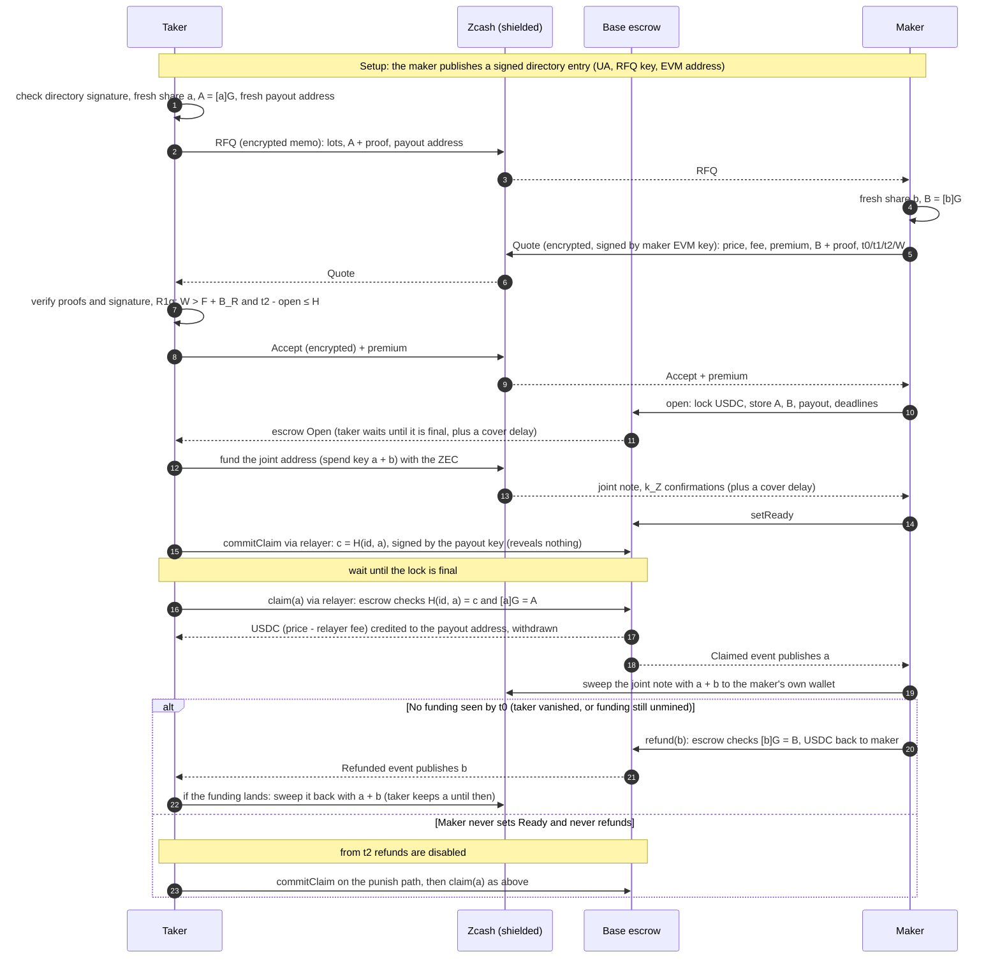

# One Cloakroom swap, step by step

Taker sells ZEC for USDC; maker buys. The Zcash chain and the Base escrow sit in the middle, because the two
parties never talk directly: every message is an encrypted memo inside a shielded Zcash transaction, and
settlement goes through the escrow.

Source (Mermaid; GitHub renders it):

What each side ends with:

| Outcome | Taker | Maker |
|---|---|---|
| Claimed | USDC at a fresh payout address | the ZEC, swept with a + b |
| Refunded | her ZEC back, minus the premium and fees | his USDC back, plus the premium |
